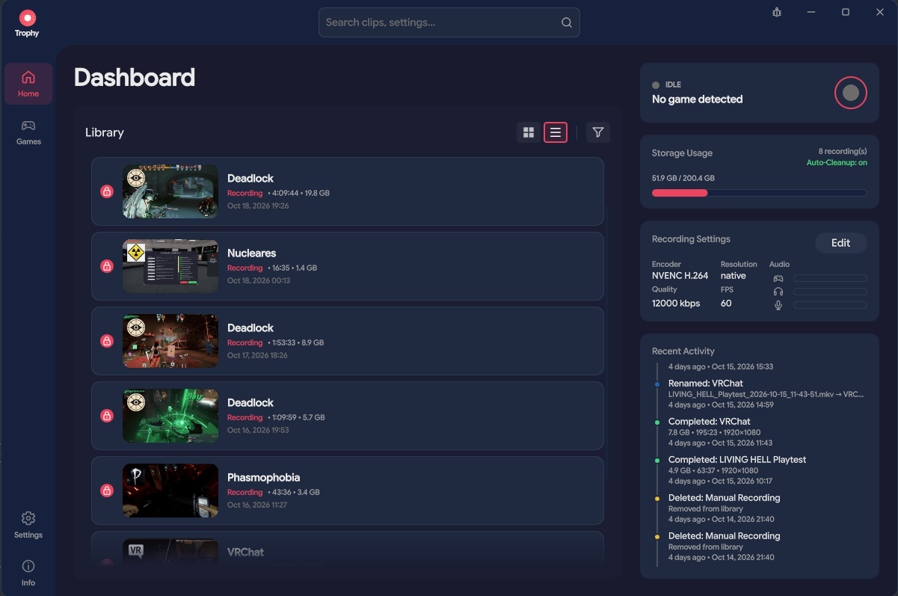
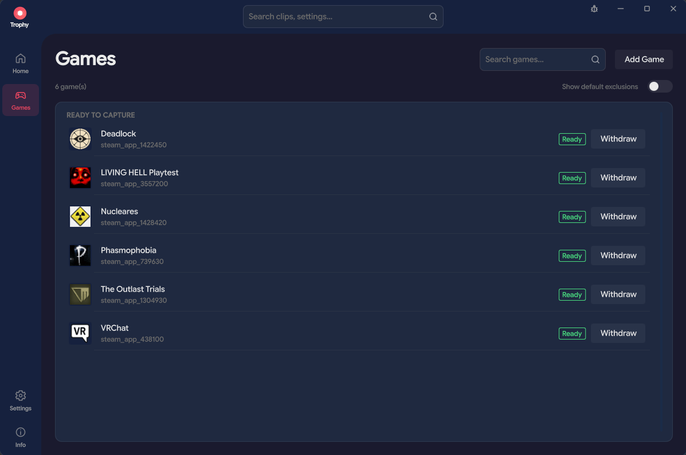
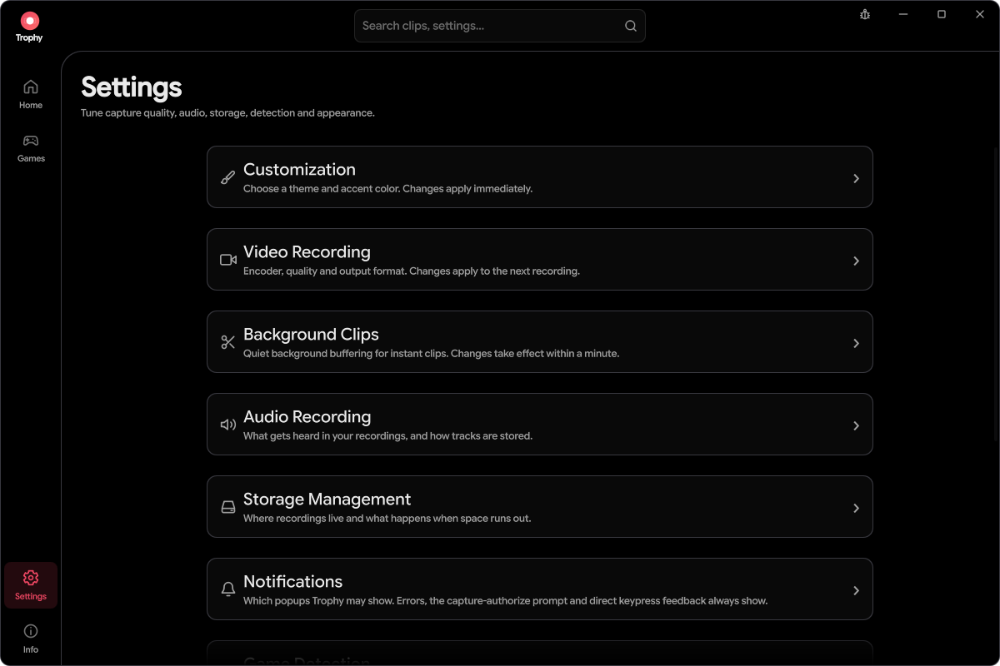
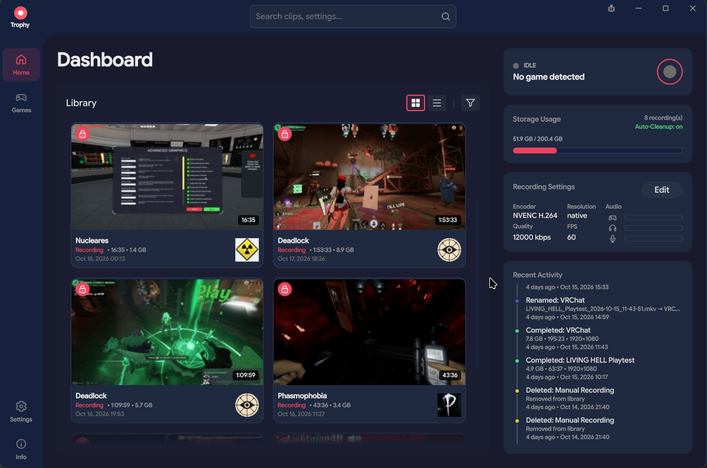
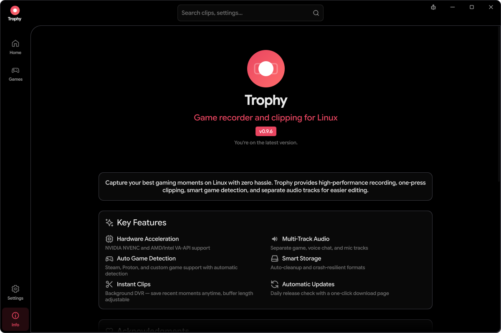

<div align="center">
  
  <h1>Trophy</h1>
  <p><strong>A performant clipping/recording tool for Linux.</strong></p>
  <p>Take clips, record full sessions, save the moment you just missed, and turn your best plays into share-ready videos.</p>
</div>

[](https://github.com/stevenjwheeler/Trophy/releases/latest)
[](LICENSE)


<p align="center">
  <a href="docs/images/dashboard.png"></a>
</p>

## Capture now, find the good parts later

Trophy is a game recorder and clipping app built for Linux on Wayland. Keep a full recording or use the replay buffer to save recent gameplay without keeping an entire session. Review, trim, and export from the same app.

- **Record your way.** Start and stop manually, or enable automatic recording for detected, authorized games.
- **Save what just happened.** Press your clip shortcut to save recent gameplay from the replay buffer. During a full recording, the same key bookmarks the moment instead.
- **Keep control of your audio.** Capture game audio, voice chat, and microphone separately, or record a mix. Review individual tracks with waveforms and mute controls.
- **Make a clip, not a project.** Use the built-in player, timeline bookmarks, and clip editor to find and snip the parts worth keeping.
- **Share without changing the original.** Export H.264/AAC MP4 copies, choose the audio to include, and queue multiple exports in the background.
- **Keep your library manageable.** Browse animated previews, search and filter captures, protect favorites from automatic cleanup, and manage your library with ease.
- **Keep your private stuff private.** Trophy only records the games you approve. It only sees screens you share through your desktop's screen-sharing portal, and you can withdraw approval from the Games page at any time.
- **Make it yours.** Customization options let you change the look, feel and colors of Trophy to match your style.

## Take a look around

<p align="center">
  <a href="docs/images/games-list.png"></a>
  &nbsp;
  <a href="docs/images/settings.png"></a>
</p>

<p align="center"><sub>Approve each detected game from the notification before Trophy can capture it, and withdraw that permission in your Games list.
Tune video, audio, clips, storage, appearance and more in Settings.</sub></p>

<p align="center">
  <a href="docs/images/dashboard-grid.png"></a>
  &nbsp;
  <a href="docs/images/info.png"></a>
</p>

<p align="center"><sub>Switch the library between grid and list layouts. The About page shows your version and app details, and checks for updates.</sub></p>

## Built for your Linux desktop

Trophy captures through PipeWire and the system screen-sharing portal. NVIDIA NVENC and AMD/Intel VA-API encoding are available where supported, with software H.264 as an alternative. Codec availability, including H.264, HEVC, and AV1, depends on your hardware and drivers.

DMA-BUF capture avoids CPU pixel copies where the compositor, driver, and encoder support it, and falls back to CPU-backed capture otherwise.

Recordings use MKV for crash-resilient recording; share exports create separate MP4 files. A clean dark interface, configurable accent colors, and a system tray keep the controls close without getting in the way.

**A Wayland session is required.** Games running through XWayland can be captured; native X11 desktop sessions are not supported. Capture, global shortcuts, and game detection depend on your compositor and portal backend. See the [system requirements and package compatibility](https://gettrophy.app/docs/getting-started.html#requirements).

## Get Trophy

**Before downloading:** check the [requirements table for AppImage, DEB, RPM and tar.xz](https://gettrophy.app/docs/getting-started.html#package-compatibility).

Download **`Trophy-<version>-x86_64.AppImage`** from the [latest release](https://github.com/stevenjwheeler/Trophy/releases/latest), make it executable, and launch it:

```bash
chmod +x Trophy-<version>-x86_64.AppImage
./Trophy-<version>-x86_64.AppImage
```

CI also produces `.tar.xz`, `.deb`, and `.rpm` packages. Check the release assets for available downloads and see the [installation guide](https://gettrophy.app/docs/getting-started.html) and [packaging notes](packaging/README.md) for details.

Replace `<version>` with the downloaded version. The setup wizard walks you through storage, audio, and the desktop integration Trophy needs for game detection. Game capture requires your authorization through the system portal.

The full documentation is on the website at **[gettrophy.app/docs](https://gettrophy.app/docs/)**: [Getting started](https://gettrophy.app/docs/getting-started.html) · [User guide](https://gettrophy.app/docs/user-guide.html) · [Build from source](https://gettrophy.app/docs/development.html)

## A few things to know

- Game detection's Vulkan and OpenGL reporters are optional. **Anti-cheat compatibility is not guaranteed.** The OpenGL option uses session-wide preload configuration and requires a fresh login environment; [read the setup guidance](https://gettrophy.app/docs/getting-started.html#game-detection) before enabling it.
- Game audio falls back to the desktop mix when an application-specific source is unavailable. That mix can include other apps; [check your audio setup](https://gettrophy.app/docs/user-guide.html#audio).
- MP4 export is whole-file and uses software encoding. Snip a clip first to share a shorter range. Size targets are approximate, and HDR-to-SDR conversion is not supported.

## Help and contribute

Found a problem or have an idea? [Open an issue](https://github.com/stevenjwheeler/Trophy/issues). Trophy's bug-report action can prepare version, system, and recent log details for you to review before sharing.

Code and documentation contributions are welcome. See the [development guide](https://gettrophy.app/docs/development.html) for build and test instructions, and [packaging notes](packaging/README.md) for AppImage and integration details.

Trophy is free and open-source software under the [GNU GPL v3](LICENSE), built with [Qt](https://www.qt.io/), [FFmpeg](https://ffmpeg.org/), and [PipeWire](https://pipewire.org/).

## Development disclosure

**Trophy is designed and maintained by a trained software developer.** AI tools assist with parts of development; they do not replace the developer's engineering judgment. Architecture, implementation decisions, code review, and testing remain developer-led, with the developer retaining responsibility for the project. The developer has and continues to actively use this project on their own system.
